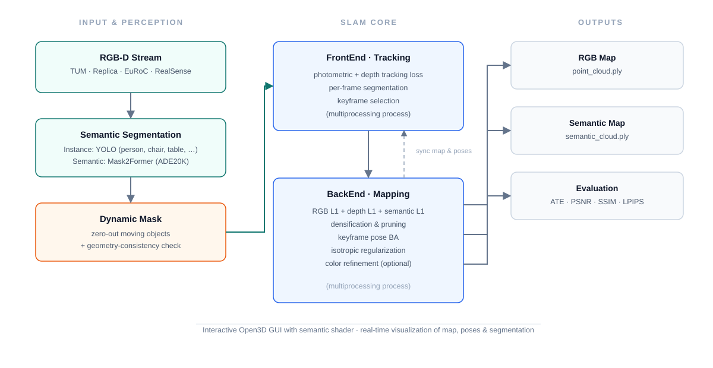

<div align="center">

# DynaSem-GS

**Semantic 3D Gaussian Splatting SLAM for Dynamic Environments**

Real-time dense **semantic RGB-D SLAM** built on top of
[Gaussian Splatting SLAM (MonoGS)](https://github.com/muskie82/MonoGS) (CVPR 2024).
DynaSem-GS endows every 3D Gaussian with **semantic features**, detects and removes
**moving objects** before tracking/mapping, and produces both an RGB and a **semantic
point cloud** of the static scene.

[](https://pytorch.org)
[](https://developer.nvidia.com/cuda-toolkit)
[](https://www.python.org)
[](LICENSE)
[](#installation)
[](#acknowledgement)

</div>

---

## Table of Contents

- [Highlights](#highlights)
- [Pipeline Overview](#pipeline-overview)
- [Installation](#installation)
- [Dataset Preparation](#dataset-preparation)
- [Configuration](#configuration)
- [Running](#running)
- [Evaluation and Outputs](#evaluation-and-outputs)
- [Repository Structure](#repository-structure)
- [License](#license)
- [Acknowledgement](#acknowledgement)

---

## Highlights

- **Semantic 3D Gaussian representation.** Every Gaussian carries both RGB
  spherical-harmonic (SH) features and *semantic SH features* (`_semantic_dc` /
  `_semantic_rest`). The same differentiable rasterizer is reused to render either
  photometric or semantic images, so semantics are optimized jointly with geometry.
- **Two pluggable segmentation backends.**
  - `Instance` (default): [Ultralytics YOLO](https://docs.ultralytics.com/) instance
    segmentation (`model/yolo11m-seg.pt`), which gives per-instance masks and unique
    instance IDs.
  - `Semantic`: [MMSegmentation](https://github.com/open-mmlab/mmsegmentation)
    Mask2Former (`mask2former_swin-t_8xb2-160k_ade20k-512x512`) with ADE20K classes,
    which gives dense pixel-level semantic labels.
- **Dynamic-object handling.**
  - Dynamic classes (e.g., *person*) are detected from segmentation masks and their RGB
    pixels are masked out before feature extraction / tracking.
  - For RGB-D input, a **geometry-consistency check** additionally invalidates pixels
    whose rendered depth disagrees with the observed depth (configurable via
    `dynamic_depth_ratio`).
  - The semantic mapping loss only supervises static regions.
- **Joint optimization.** The mapping loss combines RGB L1, depth L1, and masked
  semantic L1 losses with standard 3DGS densification / pruning, plus optional
  keyframe pose refinement and a final color-refinement stage.
- **Semantic map output.** The final map is exported as both a standard Gaussian PLY
  (`point_cloud.ply`) and a **semantic PLY** (`semantic_cloud.ply`).
- **Interactive GUI.** Live visualization of the reconstruction with a *Semantic* shader,
  semantic image / overlay panels, keyframe window, camera frustums, and pause/resume.

---

## Pipeline Overview



The system runs **three processes**: a frontend (tracking + segmentation), a backend
(mapping / bundle adjustment), and an optional GUI, coordinated through message queues.

---

## Installation

### Requirements

- **OS:** Linux or Windows (a display is required for the GUI; set `use_gui: False`
  for headless servers).
- **GPU:** NVIDIA GPU with CUDA support (**CUDA 11.8** is assumed by `environment.yml`).
- **Tools:** `conda`, a C++ compiler compatible with PyTorch extensions
  (gcc on Linux, MSVC on Windows), and the CUDA Toolkit (for `nvcc`).

### 1. Clone the repository

```bash
git clone https://github.com/Sun173558/DynaSem-GS.git
cd DynaSem-GS
```

> The two CUDA extensions in `submodules/` are built from local source by
> `environment.yml` (see below). `third_party/glm` is vendored inside
> `submodules/diff-gaussian-rasterization`, so no extra git submodules are required
> for a normal build.

### 2. Create the conda environment

```bash
conda env create -f environment.yml
conda activate semgs
```

`environment.yml` (environment name: **semgs**) installs:

| Component | Version |
|---|---|
| Python | 3.10 |
| PyTorch | 2.0.0 (CUDA 11.8) |
| torchvision / torchaudio | 0.15.0 / 2.0.0 |
| opencv-python | 4.8.1.78 |
| numpy | 1.25.0 |
| evo | 1.11.0 (ATE evaluation) |
| open3d | 0.17.0 |
| + `submodules/simple-knn`, `submodules/diff-gaussian-rasterization` | built from source |

Compiling the two CUDA extensions can take a few minutes. If it fails, make sure
`nvcc` is on your `PATH` and matches your PyTorch CUDA version.

### 3. Segmentation backends

**Instance segmentor (default).** Uses Ultralytics YOLO. The weights
`model/yolo11m-seg.pt` are **not** bundled in this repository; Ultralytics
automatically downloads them on first use (or place them manually at
`model/yolo11m-seg.pt`). The model path / confidence threshold can be changed in
`utils/instance_utils.py` (`InstanceSegmentor.__init__`).

**Semantic segmentor (optional).** Requires MMSegmentation (not listed in
`environment.yml`):

```bash
pip install -U openmim
mim install mmengine mmcv mmdet mmsegmentation
```

The Mask2Former weights are downloaded automatically by `MMSegInferencer` on first use.

### 4. Sanity check

```bash
python -c "import torch; from gaussian_splatting.scene.gaussian_model import GaussianModel; from diff_gaussian_rasterization import GaussianRasterizer; from simple_knn._C import distCUDA2; print('OK', torch.cuda.is_available())"
```

---

## Dataset Preparation

### TUM RGB-D

```bash
bash scripts/download_tum.sh        # downloads fr1_desk, fr2_xyz, fr3_long_office_household
```

Expected layout (standard TUM RGB-D format):

```
datasets/tum/rgbd_dataset_freiburg1_desk/
├── rgb/                # color frames
├── depth/              # depth frames
├── rgb.txt
├── depth.txt
└── groundtruth.txt
```

### Bonn RGB-D Dynamic

Bonn sequences use the **same TUM RGB-D format**, so they are loaded with the `tum`
dataset type. Download sequences from the
[Bonn RGB-D Dynamic dataset](https://www.ipb.uni-bonn.de/html/projects/RGBD_dynamics/)
website (e.g. `walking_static`, `sitting_static`) and place them as:

```
datasets/bonn/<sequence>/
├── rgb/                # color frames
├── depth/              # depth frames
├── rgb.txt
├── depth.txt
└── groundtruth.txt
```

> Bonn camera intrinsics: `fx=535.4, fy=539.2, cx=320.1, cy=247.6` (no distortion).
> See `configs/rgbd/tum/fr3.yaml` for an example configuration.

### Supported datasets

| `Dataset.type` | `sensor_type` | Notes |
|---|---|---|
| `tum` | `depth` | RGB-D; also used for Bonn sequences (same format); `monocular` supported |
| `realsense` | `depth` / `monocular` | live sensor; forces GUI on |

---

## Configuration

Every run is driven by a YAML config file (passed with `--config`); without one the
program will not start. All parameters already have defaults in
`configs/rgbd/tum/base_config.yaml`, and per-sequence configs use an `inherit_from`
key to recursively inherit and merge that base config (see `utils/config_utils.py`).

For a new sequence you normally only need to override two things: `dataset_path` and
the camera `Calibration`. A minimal config looks like:

```yaml
inherit_from: configs/rgbd/tum/base_config.yaml
Dataset:
  dataset_path: "datasets/tum/rgbd_dataset_freiburg1_desk"
  Calibration:
    fx: 517.3
    fy: 516.5
    cx: 318.6
    cy: 255.3
```

Frequently used optional switches (all defined with defaults in `base_config.yaml`):
`segmentor` (`Instance` / `Semantic`), `remove_dynamic`, `dynamic_depth_ratio`,
`use_gt_pose`, `post_training`, and the tracking / mapping iteration counts.

---

## Running

Activate the environment and launch SLAM with a config:

```bash
conda activate semgs
python slam.py --config configs/rgbd/tum/fr1.yaml
```

Examples for other scenes: replace `fr1.yaml` with `fr2.yaml` / `fr3.yaml` (TUM),
or create an analogous config for Bonn sequences (see `configs/rgbd/tum/fr3.yaml`).

### GUI usage

When `use_gui: True`, an Open3D window (2560 × 1600) opens with:

- **Resume/Pause** toggle;
- **Viewpoint options**: follow camera / from-behind, viewpoint list;
- **Object display**: cameras, active window, axis;
- **Geometry shaders**: Depth, Opacity, Time shader, **Semantic**, Elipsoid shader;
- **Semantic Image / Semantic Overlay** panels showing the segmentation of the
  current frame.

Tick **Semantic** to render the map with the learned semantic features instead of RGB.

### Headless mode

Set `use_gui: False` in the config (or run on a machine without a display). The
pipeline still produces the full evaluation and point clouds.

### Post-training (optional)

Set `post_training: True` to run a final color-refinement stage
(`color_refinement` in `utils/slam_backend.py`) after SLAM finishes; results are then
saved under `after_opt/` and re-evaluated.

---

## Evaluation and Outputs

After a run, the following are computed automatically and logged to
`Results.save_dir` (default `results/`):

| Metric | Tool | Description |
|---|---|---|
| **ATE (RMSE)** | `evo` | Absolute trajectory error on all frames and on keyframes |
| **PSNR / SSIM / LPIPS** | custom / torchmetrics | Novel-view rendering quality (train/val split by keyframes) |
| **FPS** | — | Average processing speed |
| **PLY maps** | — | RGB Gaussian cloud + semantic Gaussian cloud |

Output directory layout (sequence is inferred from `dataset_path`):

```
results/<dataset>_<seq>/<YYYY-MM-DD-HH-MM-SS>/
├── config.yml                        # copy of the run config
├── before_opt/                       # metrics/maps before post-training
│   ├── point_cloud/point_cloud.ply   # standard 3DGS map
│   ├── semantic_cloud/semantic_cloud.ply   # semantic map (semantic SH)
│   ├── eval_slam/
│   │   ├── stats_allframes.json      # evo APE statistics (all frames)
│   │   ├── stats_keyframes.json      # evo APE statistics (keyframes)
│   │   ├── ate_results.json
│   │   └── traj_allframes.png / traj_keyframes.png
│   ├── eval_render/
│   │   ├── final_result.json         # PSNR/SSIM/LPIPS over all frames
│   │   ├── train_result.json
│   │   └── val_result.json
│   └── render/                       # rendered novel views (+ images/ = GT)
└── after_opt/                        # same structure, only if post_training: True
```

If `use_wandb: True`, the metrics are also pushed to Weights & Biases
(project `MonoGS`, table `Metrics` with `Before`/`After` rows).

---

## Repository Structure

```
DynaSem-GS/
├── slam.py                       # entry point: config, processes, eval, logging
├── environment.yml               # conda environment (CUDA 11.8 / PyTorch 2.0)
├── configs/rgbd/tum/             # YAML configs (base + per-sequence)
├── utils/
│   ├── slam_frontend.py          # tracking process: segmentation, tracking, keyframes
│   ├── slam_backend.py           # mapping process: BA, densify/prune, refinement
│   ├── slam_utils.py             # losses (tracking/mapping/semantic), depth helpers
│   ├── semantic_utils.py         # SemanticSegmentor (MMSeg Mask2Former, ADE20K)
│   ├── instance_utils.py         # InstanceSegmentor (Ultralytics YOLO)
│   ├── camera_utils.py           # Camera object (semantic-aware)
│   ├── dataset.py                # TUM / Bonn / RealSense parsers
│   ├── eval_utils.py             # ATE (evo), PSNR/SSIM/LPIPS, PLY export
│   ├── config_utils.py           # YAML inheritance loader
│   ├── pose_utils.py             # SE(3) pose update (Lie algebra)
│   └── ...
├── gaussian_splatting/
│   ├── scene/gaussian_model.py   # GaussianModel with semantic SH features
│   └── gaussian_renderer/        # differentiable renderer wrapper (semantic mode)
├── gui/
│   ├── slam_gui.py               # Open3D GUI (semantic shader, panels)
│   └── gl_render/                # OpenGL fallback renderer
├── submodules/
│   ├── diff-gaussian-rasterization/   # MonoGS rasterizer (pose Jacobians)
│   └── simple-knn/                    # KNN for point initialization
├── scripts/                      # dataset download scripts
├── docs/                         # figures and implementation notes
└── model/                        # put YOLO weights here (yolo11m-seg.pt)
```

### Key implementation notes

- **Semantic Gaussians.** `GaussianModel` stores `_semantic_dc` / `_semantic_rest`
  alongside `_features_dc` / `_features_rest`. `create_pcd_from_image()` builds RGB and
  semantic point clouds from the same depth, then converts both to SH coefficients.
  Densification (clone/split), pruning, opacity resets and optimizer bookkeeping all
  propagate to the semantic parameters.
- **Semantic rendering.** `gaussian_renderer/__init__.py` exposes `render(..., semantic=True)`,
  which feeds `get_semantics()` (instead of `get_features()`) into the rasterizer —
  no CUDA changes are needed for semantics.
- **Dynamic masking.** At camera creation, segmentation runs once per frame; the
  dynamic mask is used to (1) zero out dynamic RGB pixels, (2) mask the semantic loss.
  For RGB-D, `detect_and_invalidate_dynamic_pixels()` in the frontend additionally
  removes pixels whose `observed_depth / rendered_depth < dynamic_depth_ratio`.
- **Losses.** Tracking: masked RGB L1 + depth L1 (`alpha` weighted). Mapping: RGB L1 +
  depth L1 + semantic L1 (masked) + isotropic regularization, with 3DGS
  densification/pruning and keyframe-pose refinement (`pose_window`).

---

## License

This repository is released under the [MIT License](LICENSE).

**Important notice:** the core rendering stack is derived from
[3D Gaussian Splatting](https://github.com/graphdeco-inria/gaussian-splatting) and
[Gaussian Splatting SLAM (MonoGS)](https://github.com/muskie82/MonoGS), both of which
are released for **non-commercial research and evaluation use** only. Please review
`gaussian_splatting/LICENSE.md` and `submodules/diff-gaussian-rasterization/LICENSE.md`
before any commercial use of those components.

## Acknowledgement

This project builds upon MonoGS and 3DGS; the segmentation backends use
[MMSegmentation](https://github.com/open-mmlab/mmsegmentation) and
[Ultralytics YOLO](https://github.com/ultralytics/ultralytics).

---

*See `docs/implementation_notes_zh.md` for a Chinese-language walkthrough of the
semantic implementation.*
